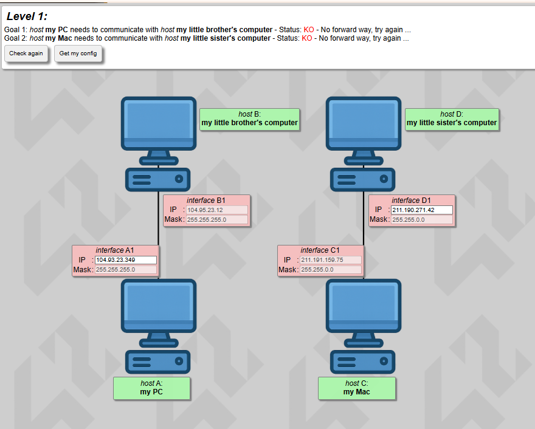
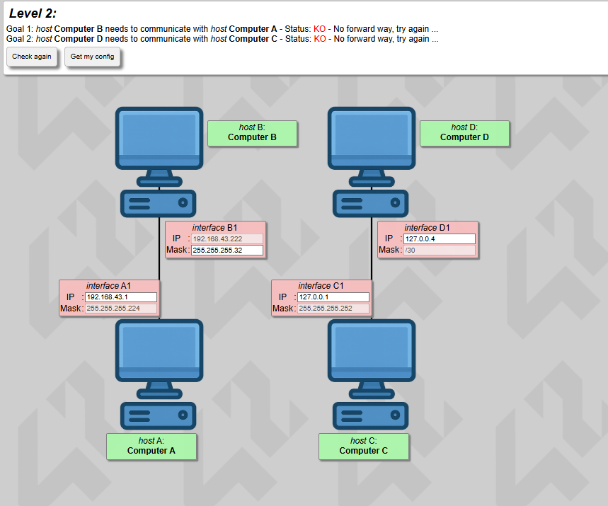
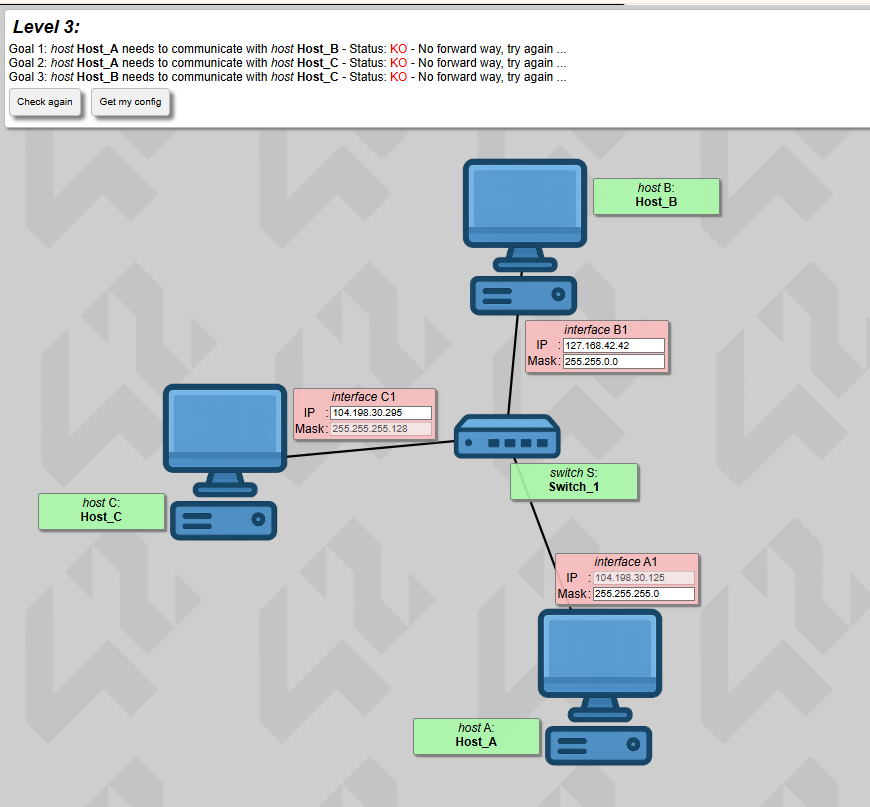
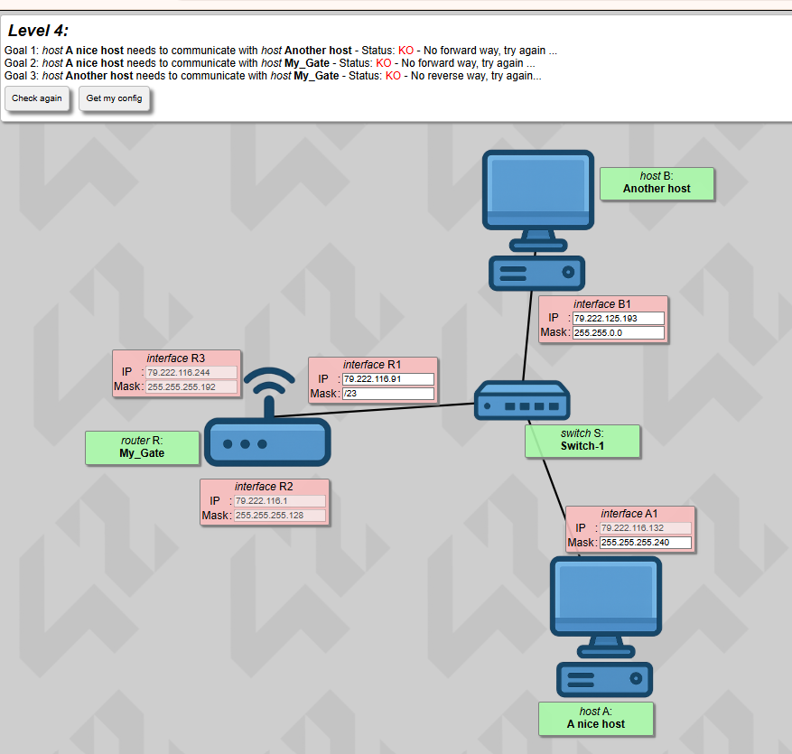
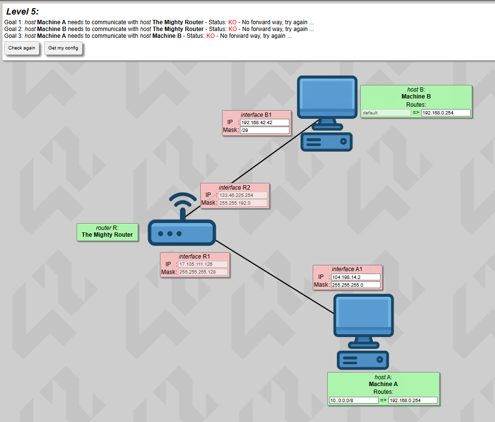
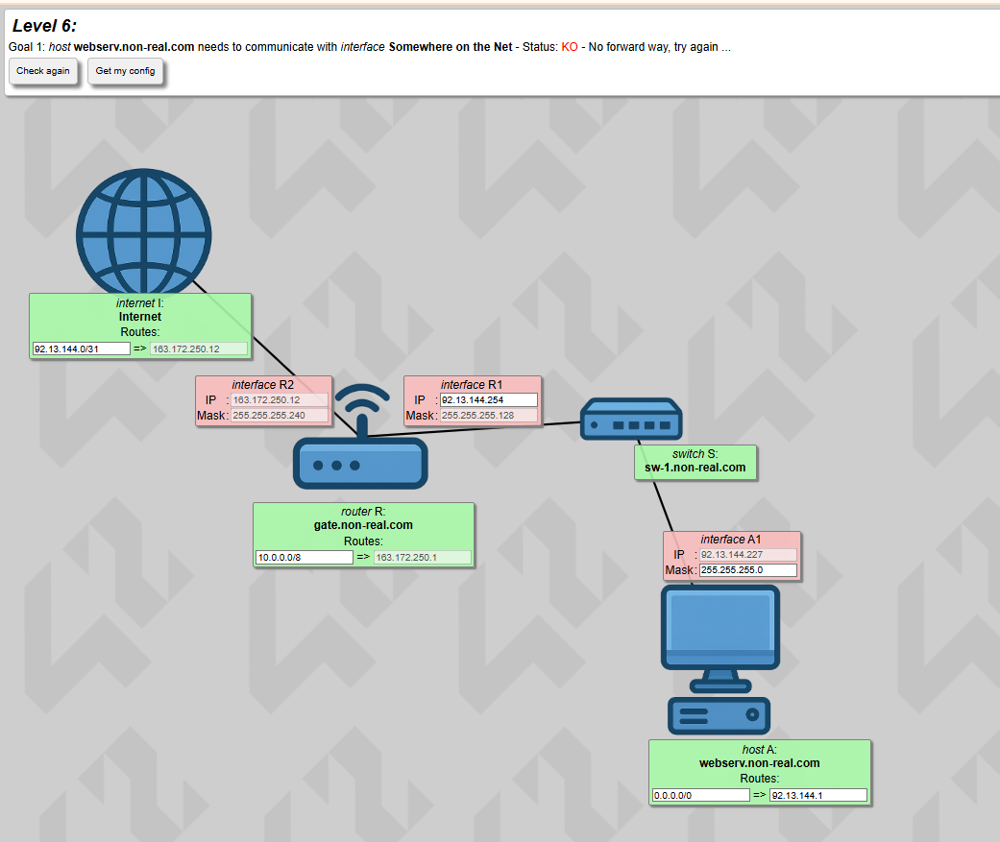
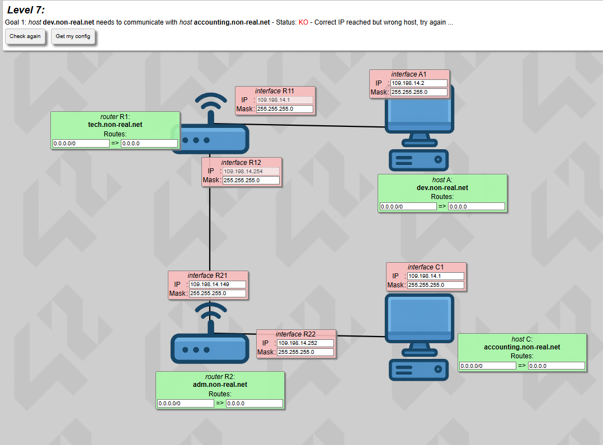
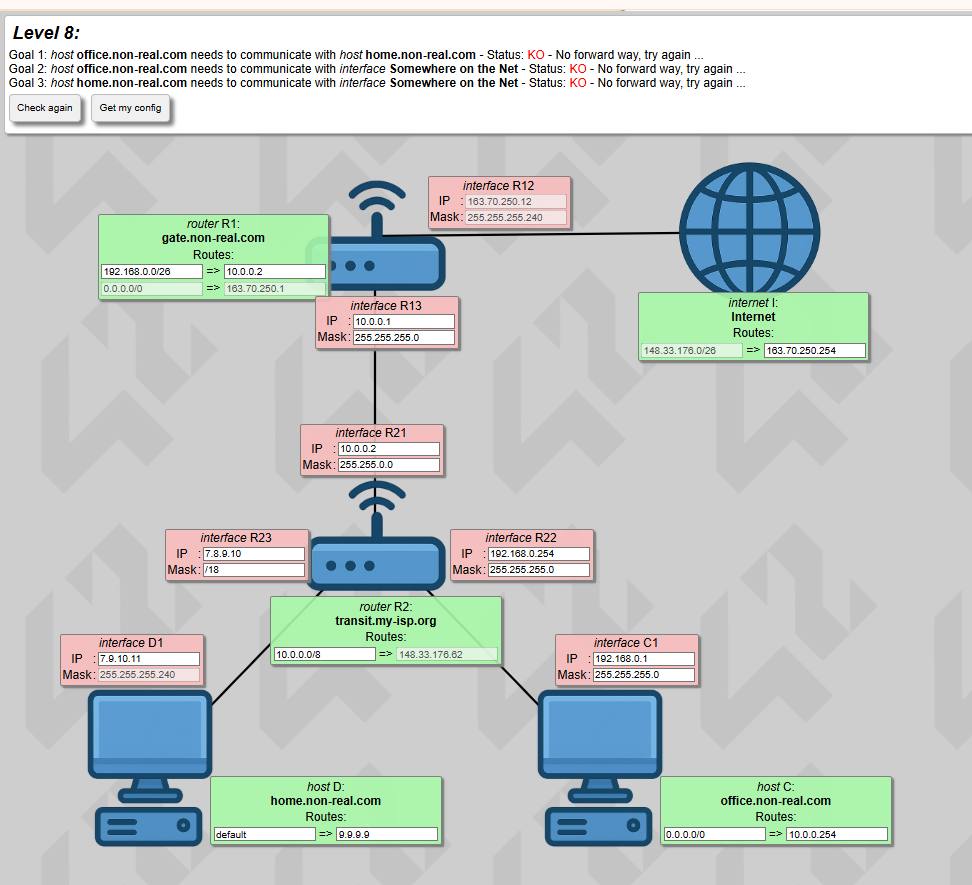
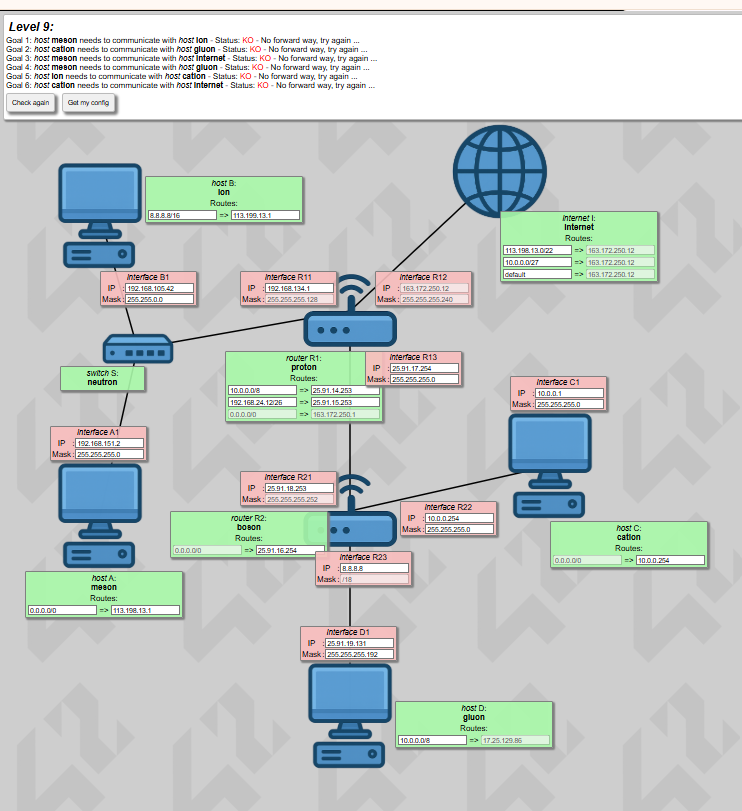
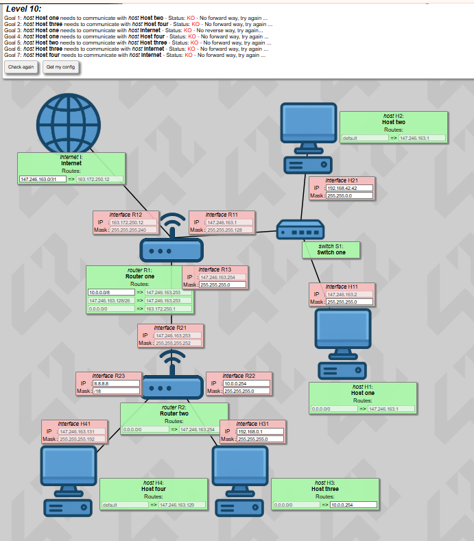

<div dir="rtl">

# 🌌 NetPractice — دليل المجرّة

[English](README.md) · **العربية**

دليل لمشروع **NetPractice** في 42، مستوى بعد مستوى: النظرية التي يختبرها كل مستوى، والحل لإعداد حقيقي واحد، والفخاخ، وطريقة تحلّ بها **أي** أرقام تعطيك إياها اللعبة.

> ⚠️ اللعبة تولّد أرقاماً جديدة في كل محاولة. الحلول هنا لإعداد واحد محدّد (الظاهر في صورة كل مستوى). تعلّم **الطريقة**، لا الإجابات.

---

## 📑 المحتوى

- [الخلاصة الأساسية](#-الخلاصة-الأساسية)
- [المستوى 1: جهازان وكابل واحد](#المستوى-1-جهازان-وكابل-واحد)
- [المستوى 2: الأقنعة غير الكاملة](#المستوى-2-الأقنعة-غير-الكاملة)
- [المستوى 3: المحوّل](#المستوى-3-المحوّل)
- [المستوى 4: أول موجّه](#المستوى-4-أول-موجّه)
- [المستوى 5: جداول التوجيه](#المستوى-5-جداول-التوجيه)
- [المستوى 6: الإنترنت](#المستوى-6-الإنترنت)
- [المستوى 7: سلسلة الموجّهات والتقسيم](#المستوى-7-سلسلة-الموجّهات-والتقسيم)
- [المستوى 8: قراءة الأدلّة في المسارات](#المستوى-8-قراءة-الأدلّة-في-المسارات)
- [المستوى 9: ستة أهداف في خريطة واحدة](#المستوى-9-ستة-أهداف-في-خريطة-واحدة)
- [المستوى 10: المجرّة الكاملة](#المستوى-10-المجرّة-الكاملة)
- [قائمة الطيران: حلّ أي مستوى](#-قائمة-الطيران-حلّ-أي-مستوى)

---

## 🧠 الخلاصة الأساسية

### عنوان IP والقناع

- عنوان IPv4 من **4 أجزاء** (كل جزء 8 بتات، والمجموع 32 بتاً). كل جزء من **0 إلى 255**.
- **القناع** آحاد متتالية ثم أصفار. الآحاد تحدّد **جزء الشبكة**، والأصفار **جزء الجهاز**.
- **CIDR** = عدد الآحاد: `255.255.255.0` = `/24`.
- جزء القناع لا يأخذ إلا إحدى هذه القيم: `0 128 192 224 240 248 252 254 255`.

### عنوان الشبكة وعنوان البث

| العنوان | بتات الجهاز | يصلح لجهاز؟ |
|---|---|---|
| عنوان الشبكة | كلها 0 | ❌ |
| عنوان البث | كلها 1 | ❌ |
| ما بينهما | — | ✅ |

### حجم الكتلة (الرقم السحري)

للجزء من القناع الذي ليس 255 ولا 0 («الجزء المهم»):

```
block size   = 256 − mask octet
block start  = floor(IP octet ÷ block size) × block size   ← network address
broadcast    = block start + block size − 1
```

مثال: `192.168.43.222/27` → الكتلة 32 → الشبكة `.192`، والبث `.223`، والأجهزة `.193`–`.222`.

| CIDR | القناع | الكتلة | أجهزة صالحة |
|---|---|---|---|
| /24 | 255.255.255.0 | 256 | 254 |
| /25 | 255.255.255.128 | 128 | 126 |
| /26 | 255.255.255.192 | 64 | 62 |
| /27 | 255.255.255.224 | 32 | 30 |
| /28 | 255.255.255.240 | 16 | 14 |
| /29 | 255.255.255.248 | 8 | 6 |
| /30 | 255.255.255.252 | 4 | 2 |

### نطاقات يجب أن تعرفها

| النطاق | النوع | في NetPractice |
|---|---|---|
| `127.0.0.0/8` | Loopback | ❌ لا يعمل لجهاز أبداً |
| `0.0.0.0/8` و `224.0.0.0` فما فوق | محجوز / Multicast | ❌ |
| `10.0.0.0/8` و `172.16.0.0/12` و `192.168.0.0/16` | خاص | ✅ محلياً، ❌ نحو الإنترنت |
| كل ما سواها | عام | ✅ |

### رسائل الخطأ

| الرسالة | المعنى |
|---|---|
| `No forward way` | المرسل لا يجد طريقاً للوجهة (شبكة خاطئة، أو لا مسار يطابق، أو قفزة لا يصل إليها). |
| `No reverse way` | الذهاب يعمل، لكن الرد لا يعود. ابحث عند المستقبل. |
| `Correct IP reached but wrong host` | عنوان مكرّر، أو شبكتان متداخلتان جعلتا المرسل يسلّم الرسالة محلياً لجهاز خطأ. |

---

## المستوى 1: جهازان وكابل واحد



**المفاهيم:** عنوان IP، والأجزاء، والثنائي، والقناع، وعنوان الشبكة والبث، وعملية AND.

**القاعدة:** جهازان متصلان مباشرة يتواصلان فقط إذا كانت عناوينهما صالحة، و**القناع نفسه**، و**جزء الشبكة نفسه**، والعنوانان **مختلفان**، وليس أحدهما عنوان شبكة أو بث.

**الرمادي ثابت، والأبيض قابل للتعديل.** ابدأ دائماً من الرمادي.

| الحقل | كان | المشكلة | الحل |
|---|---|---|---|
| A1 IP | `104.93.23.349` | `93` ≠ `95`، و `349 > 255` | `104.95.23.13` (أي `.1`–`.254` ما عدا `.12`) |
| D1 IP | `211.190.271.42` | `190` ≠ `191`، و `271 > 255` | `211.191.159.76` (أي عنوان في `211.191.0.0/16` ما عدا الشبكة والبث و `.159.75`) |

---

## المستوى 2: الأقنعة غير الكاملة



**المفاهيم الجديدة:** الأقنعة غير الكاملة (`/25`–`/30`)، وحجم الكتلة، والقناع غير الصالح، وصيغة `/n`، والنطاقات المحجوزة.

| الحقل | كان | المشكلة | الحل |
|---|---|---|---|
| B1 Mask | `255.255.255.32` | ليس قناعاً (بت 1 وحيد). و32 هو **حجم كتلة** /27 | `255.255.255.224` |
| A1 IP | `192.168.43.1` | في الكتلة 0–31، وB1 (`.222`) في الكتلة 192–223 | `192.168.43.193` (`.193`–`.221`) |
| C1 و D1 IP | `127.0.0.1` و `127.0.0.4` | `127.x` هو Loopback، و `.4` عنوان شبكة أيضاً في /30 | `192.168.1.1` و `192.168.1.2` |

> 🪤 في `/30` الأزواج الصالحة دائماً `4k+1` و `4k+2` (`.1/.2`، `.5/.6`، …).

---

## المستوى 3: المحوّل



**المفاهيم الجديدة:** المحوّل **بلا IP ولا قناع**، وكل الأجهزة على محوّل واحد **شبكة واحدة بقناع واحد**، وجمع الثوابت المتفرّقة على عدة أجهزة.

الثابت: IP عند A1 = `104.198.30.125`، وقناع عند C1 = `/25`. إذن الجميع `/25`، والكتلة `0–127`.

| الواجهة | IP | Mask |
|---|---|---|
| A1 | `104.198.30.125` 🔒 | `255.255.255.128` |
| B1 | `104.198.30.1` | `255.255.255.128` |
| C1 | `104.198.30.2` | `255.255.255.128` 🔒 |

> 🪤 قناع A1 `/24` يبدو صحيحاً، لكن القناع الثابت عند C1 (`/25`) هو الذي يُعتمد. ابحث عن الأقنعة الثابتة **في الشاشة كلها**.

---

## المستوى 4: أول موجّه



**المفاهيم الجديدة:** للموجّه شبكة لكل واجهة، و**شبكات واجهات الموجّه لا تتداخل أبداً**، حتى الواجهات بلا سلك، والفرق بين forward و reverse.

المحجوز: R2 (`0–127`) و R3 (`192–255`)، فالفراغ المتاح `128–191`. A1 ثابت = `.132`. أي قناع من `/26` إلى `/29` يصلح، واستخدمنا `/28`.

| الواجهة | IP | Mask |
|---|---|---|
| R1 | `79.222.116.129` | `255.255.255.240` |
| A1 | `79.222.116.132` 🔒 | `255.255.255.240` |
| B1 | `79.222.116.130` | `255.255.255.240` |

> 🪤 عنوان R1 `.91` يقع داخل شبكة R2، وقناع `/23` يبتلع كل شيء.

---

## المستوى 5: جداول التوجيه



**المفاهيم الجديدة:** جدول التوجيه (الوجهة ⇒ القفزة التالية)، و `default` = `0.0.0.0/0`، وأطول تطابق، و**القفزة التالية يجب أن تكون داخل شبكتك**، والشبكات المتصلة مباشرة لا تحتاج مساراً.

| الجهاز | IP | Mask | المسار |
|---|---|---|---|
| A | `17.105.111.1` | `255.255.255.128` | `default` ⇒ `17.105.111.126` |
| B | `133.46.225.1` | `255.255.192.0` | `default` 🔒 ⇒ `133.46.225.254` |

> 🪤 وجهة A كانت `10..0.0.0/8` (نقطتان متتاليتان، وشبكة خاطئة). والقفزتان كانتا `192.168.0.254`، وهو عنوان غير موجود في أي مكان.

---

## المستوى 6: الإنترنت



**المفاهيم الجديدة:** التوجيه قفزةً قفزة (كل محطة تحتاج مساراً في الاتجاهين)، و default على الموجّه نفسه، ومسار **عودة** الإنترنت إلى شبكتك، والعناوين العامة والخاصة، والتلخيص.

| المكان | التعديل |
|---|---|
| قناع A1 | `255.255.255.128` |
| Route A | `0.0.0.0/0` ⇒ `92.13.144.254` |
| Route R | `default` ⇒ `163.172.250.1` 🔒 |
| Route Internet | `92.13.144.128/25` ⇒ `163.172.250.12` 🔒 |

> 🪤 وجهة الإنترنت `/31` كانت تغطي عنوانين فقط، فلم يكن الرد يعود إلى A.

---

## المستوى 7: سلسلة الموجّهات والتقسيم



**المفاهيم الجديدة:** شبكة العبور بين الموجّهات (`/30` مثالي لها)، و**لا تداخل ولا عناوين مكرّرة في الخريطة كلها**، وتقسيم نطاق واحد إلى عدة شبكات، ومسارات الموجّهات الوسيطة.

كل الأقنعة `255.255.255.252` (`/30`):

| الواجهة | IP | | الجدول | المسار |
|---|---|---|---|---|
| A1 | `109.198.14.2` | | A | `0.0.0.0/0` ⇒ `109.198.14.1` |
| R11 | `109.198.14.1` 🔒 | | R1 | `109.198.14.8/30` ⇒ `109.198.14.253` |
| R12 | `109.198.14.254` 🔒 | | R2 | `109.198.14.0/30` ⇒ `109.198.14.254` |
| R21 | `109.198.14.253` | | C | `0.0.0.0/0` ⇒ `109.198.14.9` |
| R22 | `109.198.14.9` | | | |
| C1 | `109.198.14.10` | | | |

> 🪤 كان C1 يحمل `.1`، وهو عنوان R11 نفسه، فظهرت «Correct IP reached but wrong host».

---

## المستوى 8: قراءة الأدلّة في المسارات



**المفاهيم الجديدة:** القيم الرمادية **داخل جداول التوجيه** أدلّة. القفزة الثابتة = عنوان واجهة الجار، والوجهة الثابتة = كتلة مفروضة يجب أن تقع شبكاتك داخلها. ضع الشبكات الأكبر أولاً على حدود محاذية.

- وجهة الإنترنت `148.33.176.0/26` (ثابتة)، إذن C و D داخل `148.33.176.0–63`.
- قفزة R2 `148.33.176.62` (ثابتة)، إذن R13 = `.62`، والعبور = `60–63`.

| الواجهة | IP | Mask |
|---|---|---|
| R13 | `148.33.176.62` | `255.255.255.252` |
| R21 | `148.33.176.61` | `255.255.255.252` |
| R22 | `148.33.176.1` | `255.255.255.240` |
| C1 | `148.33.176.2` | `255.255.255.240` |
| R23 | `148.33.176.17` | `255.255.255.240` |
| D1 | `148.33.176.18` | `255.255.255.240` 🔒 |

| الجدول | المسار |
|---|---|
| C | `0.0.0.0/0` ⇒ `148.33.176.1` |
| D | `default` ⇒ `148.33.176.17` |
| R2 | `0.0.0.0/0` ⇒ `148.33.176.62` 🔒 |
| R1 | `148.33.176.0/27` ⇒ `148.33.176.61` |
| Internet | `148.33.176.0/26` 🔒 ⇒ `163.70.250.12` |

> 💡 لماذا النطاق نفسه؟ سطر الإنترنت الثابت هو كل ما يعرفه عنك، وأي عنوان خارجه لا يعود إليه الرد.

---

## المستوى 9: ستة أهداف في خريطة واحدة



**المفاهيم الجديدة:** مصفوفة الأهداف (أي محطات يمرّ بها كل هدف)، ولا يحتاج العنوان العام إلا من يتواصل مع الإنترنت، و**الموجّه الطرفي** (مخرج واحد، فيكفيه `default`) مقابل **الموجّه المركزي** (`default` للأعلى، وأسطر محدّدة للأسفل)، ووجهات مكتوبة بعنوان جهاز بدل عنوان الشبكة.

| الواجهة | IP | Mask |
|---|---|---|
| R11 | `113.198.13.1` | `/25` 🔒 |
| A1 | `113.198.13.2` | `255.255.255.128` |
| B1 | `113.198.13.3` | `255.255.255.128` |
| R13 | `25.91.16.254` | `255.255.255.252` |
| R21 | `25.91.16.253` | `/30` 🔒 |
| R22 | `113.198.14.254` | `255.255.255.0` |
| C1 | `113.198.14.1` | `255.255.255.0` |
| R23 | `17.25.129.86` | `/18` 🔒 |
| D1 | `17.25.129.87` | `255.255.192.0` |

| الجدول | المسارات |
|---|---|
| A و B | `0.0.0.0/0` ⇒ `113.198.13.1` |
| C | `default` ⇒ `113.198.14.254` |
| D | `0.0.0.0/0` ⇒ `17.25.129.86` 🔒 |
| R1 | `113.198.14.0/24` ⇒ `25.91.16.253` · `17.25.128.0/18` ⇒ `25.91.16.253` |
| R2 | `default` ⇒ `25.91.16.254` |
| Internet | `113.198.12.0/22` و `113.198.13.0/25` و `113.198.14.0/24` ⇒ `163.172.250.12` |

> 🪤 قفزة B كانت `113.199.13.1` (199 لا 198). ووجهة الإنترنت `113.198.13.0/22` ليست عنوان شبكة، والصحيح `113.198.12.0/22`.

---

## المستوى 10: المجرّة الكاملة



**المفاهيم الجديدة:** الأدلّة المتقاطعة (كل قيمة ثابتة تؤكد أخرى)، و**سطر إنترنت واحد**: أصغر ملخّص يجمع الشبكات الثابتة يصبح سقف الخريطة كلها.

LAN1 (`0–127`) و LAN4 (`128–191`) ثابتتان، إذن سطر الإنترنت الوحيد يجب أن يكون `147.246.163.0/24`، ويجب أن يدخل H3 في الفراغ `192–251`.

| الحقل | القيمة الجديدة |
|---|---|
| قناع H11 | `255.255.255.128` |
| H21 | `147.246.163.3` / `255.255.255.128` |
| قناع R13 | `255.255.255.252` |
| R22 | `147.246.163.193` / `255.255.255.252` |
| H31 | `147.246.163.194` / `255.255.255.252` |
| R23 | `147.246.163.129` / `255.255.255.192` |
| قفزة H3 | `147.246.163.193` |
| R1 السطر 1 | `147.246.163.192/30` ⇒ `147.246.163.253` 🔒 |
| Internet | `147.246.163.0/24` ⇒ `163.172.250.12` 🔒 |

---

## 🚀 قائمة الطيران: حلّ أي مستوى

1. **ارسم الشبكات.** كل سلك أو محوّل = شبكة واحدة. وكل واجهة موجّه شبكة منفصلة. والإنترنت محطة لها جدولها.
2. **اجمع الرمادي كله.** العناوين والأقنعة **والمسارات**. القفزة الثابتة = عنوان الجار، والوجهة الثابتة = كتلة مفروضة.
3. **صحّح المستحيل.** أجزاء > 255، و `127.x`، وأقنعة غير متصلة، ووجهات ليست عنوان شبكة، وصيغ مكسورة.
4. **ارسم مصفوفة الأهداف.** من يتواصل مع من؟ ومن يحتاج الإنترنت (فيحتاج عنواناً عاماً)؟
5. **صمّم الخريطة.** الثوابت أولاً، ثم الأكبر فالأصغر في الفراغات. لا تداخل، ولا تكرار، وداخل الكتل المفروضة.
6. **املأ الواجهات.** القناع نفسه على كل سلك، وعناوين فريدة، ليست شبكة ولا بثاً أبداً.
7. **املأ المسارات.** الأجهزة: `default` نحو موجّهها. الموجّه الطرفي: `default` للأعلى. المركزي: `default` للأعلى + أسطر محدّدة للأسفل. الإنترنت: أسطر عودة لشبكاتك العامة.
8. **Check again**، ثم **Get my config**.

---

## 📁 تنظيم المستودع

```
.
├── README.md        ← English guide
├── README.ar.md     ← هذا الدليل (العربية)
└── img/
    ├── level1.png
    ├── …
    └── level10.png
```

أضف ملفات الإعدادات التي تصدّرها بزر **Get my config** إلى المستودع حسب ما تطلبه قواعد مشروعك.

---

✦ *الأرقام تتغيّر في كل محاولة، والقواعد لا تتغيّر.* ✦

</div>
