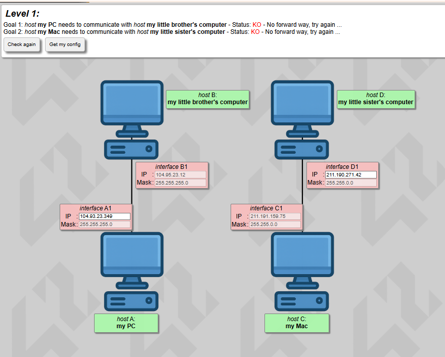
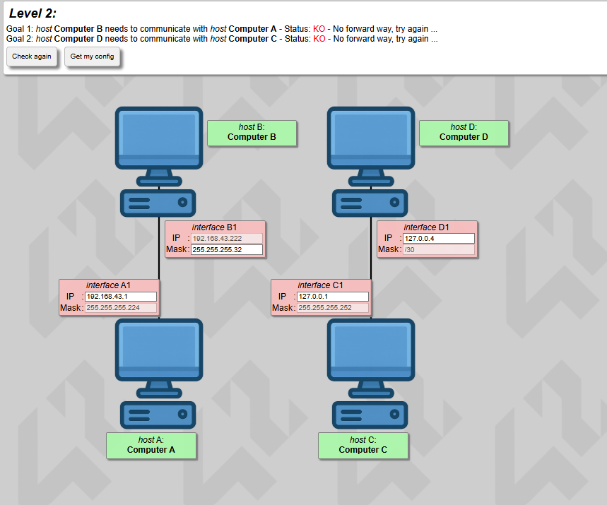
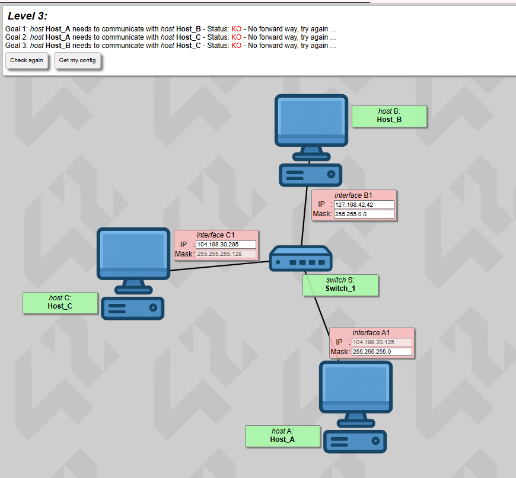
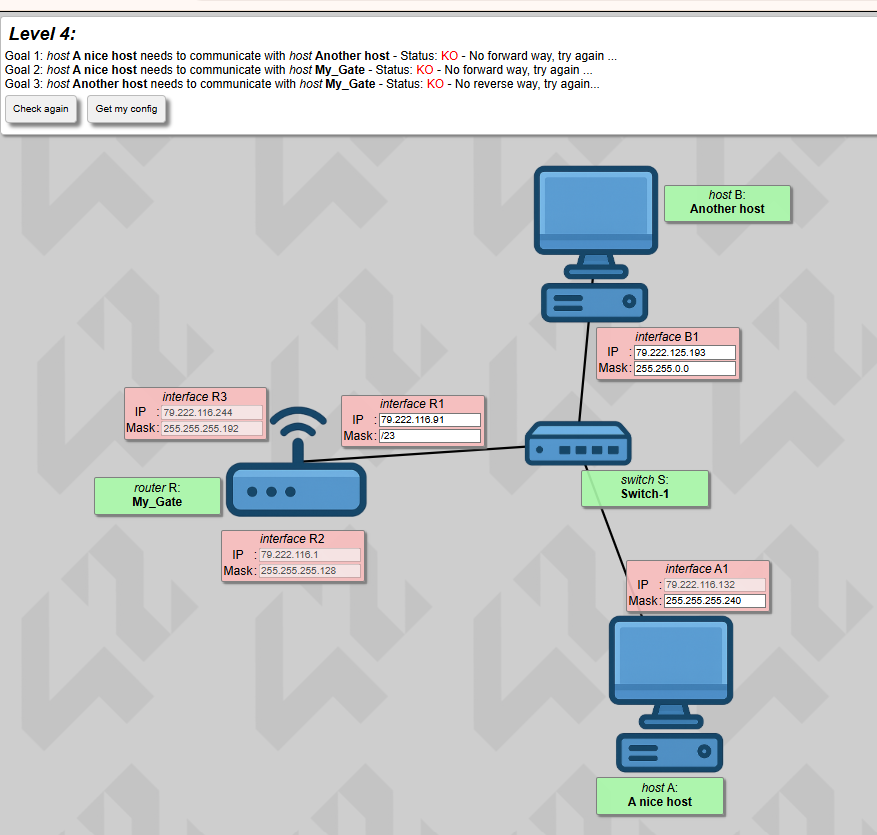
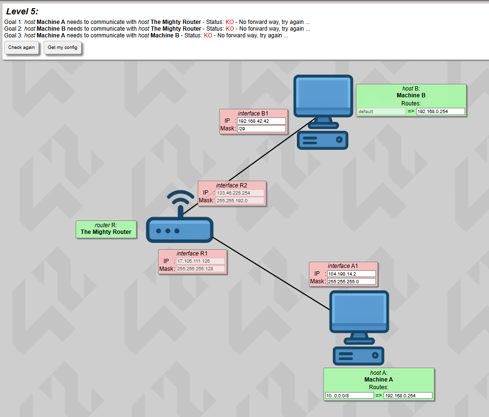
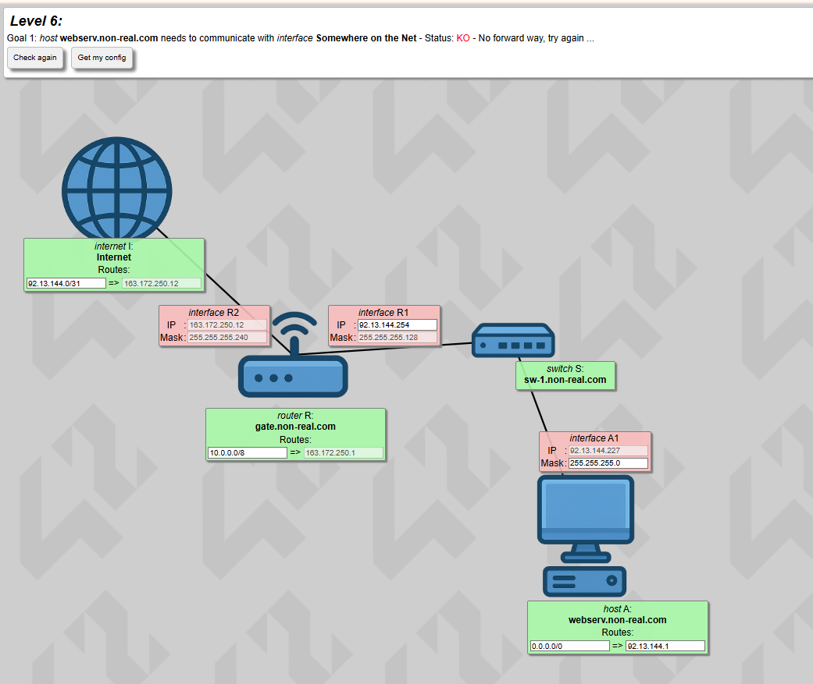
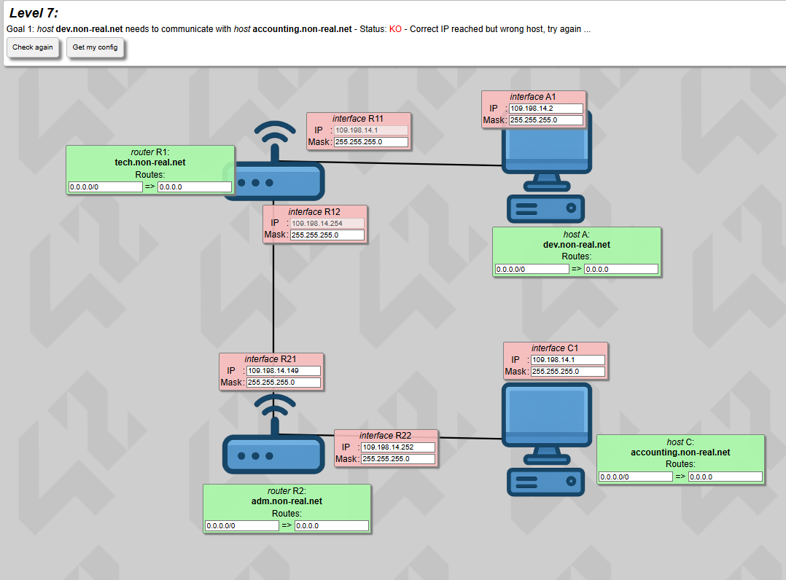
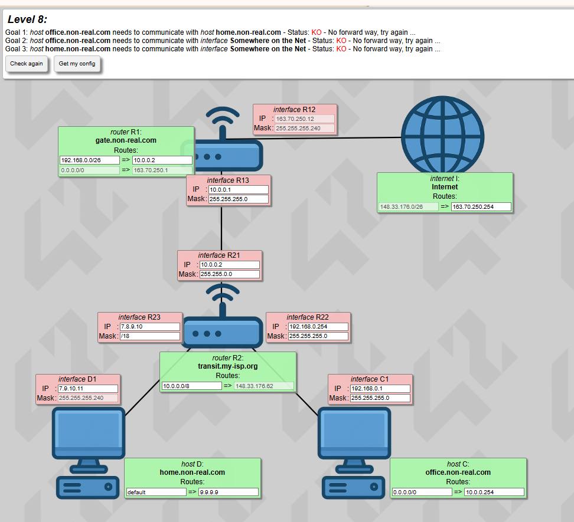
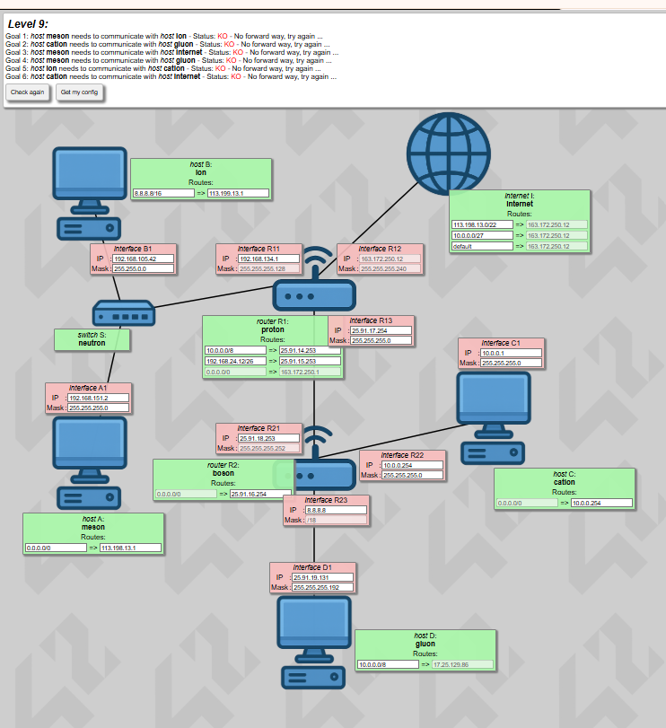
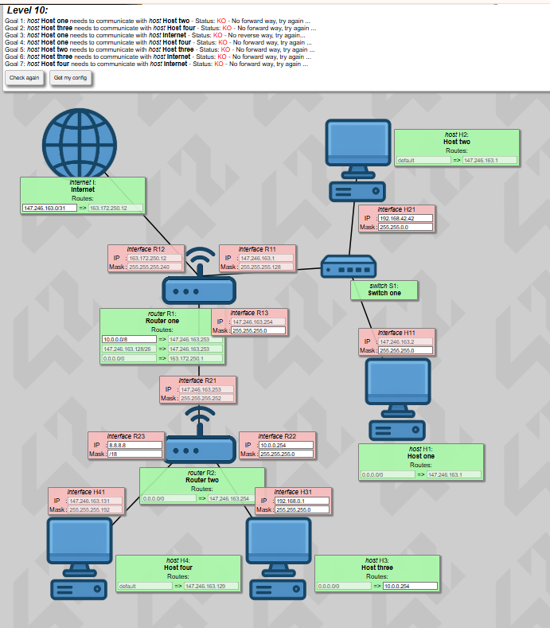

# 🌌 NetPractice — The Galaxy Guide

**English** · [العربية](README.ar.md)

A level-by-level guide to the **NetPractice** project at 42: the theory each level tests, the solution for one real configuration, the traps, and a method that works for **any** numbers the game gives you.

> ⚠️ NetPractice generates new numbers on every attempt. The solutions below are for one specific configuration (shown in each screenshot). Learn the **method**, not the answers.

---

## 📑 Contents

- [Core cheat sheet](#-core-cheat-sheet)
- [Level 1 — Two hosts, one cable](#level-1--two-hosts-one-cable)
- [Level 2 — Partial masks](#level-2--partial-masks)
- [Level 3 — The switch](#level-3--the-switch)
- [Level 4 — The first router](#level-4--the-first-router)
- [Level 5 — Routing tables](#level-5--routing-tables)
- [Level 6 — The internet](#level-6--the-internet)
- [Level 7 — Router chains and subnetting](#level-7--router-chains-and-subnetting)
- [Level 8 — Reading clues in routes](#level-8--reading-clues-in-routes)
- [Level 9 — Six goals, one map](#level-9--six-goals-one-map)
- [Level 10 — The complete galaxy](#level-10--the-complete-galaxy)
- [Flight checklist: solve any level](#-flight-checklist-solve-any-level)

---

## 🧠 Core cheat sheet

### IP address and mask

- An IPv4 address is **4 octets** (8 bits each, 32 bits total). Each octet is **0–255**.
- The **mask** is a run of 1s followed by 0s. The 1s mark the **network part**, the 0s the **host part**.
- **CIDR** = the number of 1s: `255.255.255.0` = `/24`.
- A mask octet can only be one of: `0 128 192 224 240 248 252 254 255`.

### Network and broadcast

| Address | Host bits | Usable by a host? |
|---|---|---|
| Network address | all 0 | ❌ |
| Broadcast address | all 1 | ❌ |
| Everything between | — | ✅ |

### Block size (the magic number)

For the mask octet that is neither 255 nor 0 (the "interesting octet"):

```
block size   = 256 − mask octet
block start  = floor(IP octet ÷ block size) × block size   ← network address
broadcast    = block start + block size − 1
```

Example: `192.168.43.222/27` → block 32 → network `.192`, broadcast `.223`, hosts `.193`–`.222`.

| CIDR | Mask | Block | Valid hosts |
|---|---|---|---|
| /24 | 255.255.255.0 | 256 | 254 |
| /25 | 255.255.255.128 | 128 | 126 |
| /26 | 255.255.255.192 | 64 | 62 |
| /27 | 255.255.255.224 | 32 | 30 |
| /28 | 255.255.255.240 | 16 | 14 |
| /29 | 255.255.255.248 | 8 | 6 |
| /30 | 255.255.255.252 | 4 | 2 |

### Address ranges to know

| Range | Type | In NetPractice |
|---|---|---|
| `127.0.0.0/8` | Loopback | ❌ never works for a host |
| `0.0.0.0/8`, `224.0.0.0` and above | Reserved / multicast | ❌ |
| `10.0.0.0/8`, `172.16.0.0/12`, `192.168.0.0/16` | Private | ✅ locally, ❌ toward the internet |
| Everything else | Public | ✅ |

### Error messages

| Message | Meaning |
|---|---|
| `No forward way` | The sender has no way to reach the destination (wrong network, no matching route, unreachable next hop). |
| `No reverse way` | The trip out works, but the reply can't come back. Look at the receiver's side. |
| `Correct IP reached but wrong host` | A duplicate IP, or overlapping networks made the sender deliver locally to the wrong device. |

---

## Level 1 — Two hosts, one cable



**Concepts:** IP address, octets, binary, mask, network/broadcast address, AND.

**Rule:** two directly connected hosts communicate only if they have valid addresses, the **same mask**, the **same network part**, **different** addresses, and neither is a network or broadcast address.

**Grey = fixed, white = editable.** Always start from the grey.

| Field | Was | Problem | Solution |
|---|---|---|---|
| A1 IP | `104.93.23.349` | `93` ≠ `95`, and `349 > 255` | `104.95.23.13` (any `.1`–`.254` except `.12`) |
| D1 IP | `211.190.271.42` | `190` ≠ `191`, and `271 > 255` | `211.191.159.76` (any in `211.191.0.0/16` except network, broadcast and `.159.75`) |

---

## Level 2 — Partial masks



**New concepts:** partial masks (`/25`–`/30`), block size, invalid masks, `/n` notation, reserved ranges.

| Field | Was | Problem | Solution |
|---|---|---|---|
| B1 Mask | `255.255.255.32` | Not a mask (a lone 1 bit). 32 is the **block size** of /27 | `255.255.255.224` |
| A1 IP | `192.168.43.1` | In block 0–31; B1 (`.222`) is in block 192–223 | `192.168.43.193` (`.193`–`.221`) |
| C1, D1 IP | `127.0.0.1`, `127.0.0.4` | `127.x` is loopback; `.4` is also a network address in /30 | `192.168.1.1` and `192.168.1.2` |

> 🪤 In `/30` the valid pairs are always `4k+1` and `4k+2` (`.1/.2`, `.5/.6`, …).

---

## Level 3 — The switch



**New concepts:** a switch has **no IP and no mask**; all hosts on one switch form **one network with one mask**; combine fixed values scattered across devices.

Fixed: A1 IP `104.198.30.125`, C1 mask `/25` → everyone uses `/25`, block `0–127`.

| Interface | IP | Mask |
|---|---|---|
| A1 | `104.198.30.125` 🔒 | `255.255.255.128` |
| B1 | `104.198.30.1` | `255.255.255.128` |
| C1 | `104.198.30.2` | `255.255.255.128` 🔒 |

> 🪤 A1's `/24` looks fine, but the fixed mask on C1 (`/25`) wins. Look for fixed masks **across the whole screen**.

---

## Level 4 — The first router



**New concepts:** a router has one network per interface; **a router's interface networks must never overlap**, even interfaces with no cable; forward vs reverse way.

Reserved by R2 (`0–127`) and R3 (`192–255`) → the free gap is `128–191`. Fixed A1 = `.132`. Any mask `/26`–`/29` works; `/28` is used here.

| Interface | IP | Mask |
|---|---|---|
| R1 | `79.222.116.129` | `255.255.255.240` |
| A1 | `79.222.116.132` 🔒 | `255.255.255.240` |
| B1 | `79.222.116.130` | `255.255.255.240` |

> 🪤 R1's `.91` sits inside R2's network, and `/23` swallows everything.

---

## Level 5 — Routing tables



**New concepts:** routing table (destination ⇒ next hop), `default` = `0.0.0.0/0`, longest prefix match, **the next hop must be inside your own network**, directly connected networks need no route.

| Host | IP | Mask | Route |
|---|---|---|---|
| A | `17.105.111.1` | `255.255.255.128` | `default` ⇒ `17.105.111.126` |
| B | `133.46.225.1` | `255.255.192.0` | `default` 🔒 ⇒ `133.46.225.254` |

> 🪤 A's destination was `10..0.0.0/8` (double dot, and wrong network). Both next hops were `192.168.0.254`, an address that exists nowhere.

---

## Level 6 — The internet



**New concepts:** hop-by-hop routing (every stop needs a route, both ways), the router's own default route, the internet's route **back** to your network, public vs private addresses, summarization.

| Place | Change |
|---|---|
| A1 Mask | `255.255.255.128` |
| Route A | `0.0.0.0/0` ⇒ `92.13.144.254` |
| Route R | `default` ⇒ `163.172.250.1` 🔒 |
| Route Internet | `92.13.144.128/25` ⇒ `163.172.250.12` 🔒 |

> 🪤 The internet's `/31` covered only two addresses, so replies never came back to A.

---

## Level 7 — Router chains and subnetting



**New concepts:** transit network between routers (`/30` is ideal), **no overlap and no duplicate IPs across the whole map**, subnetting one range into several networks, routes on middle routers.

All masks `255.255.255.252` (`/30`):

| Interface | IP | | Table | Route |
|---|---|---|---|---|
| A1 | `109.198.14.2` | | A | `0.0.0.0/0` ⇒ `109.198.14.1` |
| R11 | `109.198.14.1` 🔒 | | R1 | `109.198.14.8/30` ⇒ `109.198.14.253` |
| R12 | `109.198.14.254` 🔒 | | R2 | `109.198.14.0/30` ⇒ `109.198.14.254` |
| R21 | `109.198.14.253` | | C | `0.0.0.0/0` ⇒ `109.198.14.9` |
| R22 | `109.198.14.9` | | | |
| C1 | `109.198.14.10` | | | |

> 🪤 C1 had `.1`, the same as R11 → "Correct IP reached but wrong host".

---

## Level 8 — Reading clues in routes



**New concepts:** grey values **inside routing tables** are clues. A fixed next hop = the neighbor's interface address; a fixed destination = a forced block your networks must live in. Pack networks biggest-first on aligned boundaries.

- Internet destination `148.33.176.0/26` (fixed) → C and D must be inside `148.33.176.0–63`.
- R2's next hop `148.33.176.62` (fixed) → R13 = `.62`, transit = `60–63`.

| Interface | IP | Mask |
|---|---|---|
| R13 | `148.33.176.62` | `255.255.255.252` |
| R21 | `148.33.176.61` | `255.255.255.252` |
| R22 | `148.33.176.1` | `255.255.255.240` |
| C1 | `148.33.176.2` | `255.255.255.240` |
| R23 | `148.33.176.17` | `255.255.255.240` |
| D1 | `148.33.176.18` | `255.255.255.240` 🔒 |

| Table | Route |
|---|---|
| C | `0.0.0.0/0` ⇒ `148.33.176.1` |
| D | `default` ⇒ `148.33.176.17` |
| R2 | `0.0.0.0/0` ⇒ `148.33.176.62` 🔒 |
| R1 | `148.33.176.0/27` ⇒ `148.33.176.61` |
| Internet | `148.33.176.0/26` 🔒 ⇒ `163.70.250.12` |

> 💡 Why the same range? The internet's single fixed line is all it knows about you; any address outside it never gets a reply.

---

## Level 9 — Six goals, one map



**New concepts:** goal matrix (which stops each goal passes), only hosts that talk to the internet need public addresses, **stub router** (one exit → `default` is enough) vs **core router** (`default` up, specific routes down), destinations written as host addresses instead of network addresses.

| Interface | IP | Mask |
|---|---|---|
| R11 | `113.198.13.1` | `/25` 🔒 |
| A1 | `113.198.13.2` | `255.255.255.128` |
| B1 | `113.198.13.3` | `255.255.255.128` |
| R13 | `25.91.16.254` | `255.255.255.252` |
| R21 | `25.91.16.253` | `/30` 🔒 |
| R22 | `113.198.14.254` | `255.255.255.0` |
| C1 | `113.198.14.1` | `255.255.255.0` |
| R23 | `17.25.129.86` | `/18` 🔒 |
| D1 | `17.25.129.87` | `255.255.192.0` |

| Table | Routes |
|---|---|
| A, B | `0.0.0.0/0` ⇒ `113.198.13.1` |
| C | `default` ⇒ `113.198.14.254` |
| D | `0.0.0.0/0` ⇒ `17.25.129.86` 🔒 |
| R1 | `113.198.14.0/24` ⇒ `25.91.16.253` · `17.25.128.0/18` ⇒ `25.91.16.253` |
| R2 | `default` ⇒ `25.91.16.254` |
| Internet | `113.198.12.0/22`, `113.198.13.0/25`, `113.198.14.0/24` ⇒ `163.172.250.12` |

> 🪤 B's next hop was `113.199.13.1` (199, not 198). The internet's `113.198.13.0/22` isn't a network address: the correct one is `113.198.12.0/22`.

---

## Level 10 — The complete galaxy



**New concepts:** cross-checking clues (each fixed value confirms another), and **a single internet line**: the smallest summary holding the fixed networks becomes the ceiling for the whole map.

LAN1 (`0–127`) and LAN4 (`128–191`) are fixed → one internet line must be `147.246.163.0/24` → H3 must fit in the gap `192–251`.

| Field | New value |
|---|---|
| H11 Mask | `255.255.255.128` |
| H21 | `147.246.163.3` / `255.255.255.128` |
| R13 Mask | `255.255.255.252` |
| R22 | `147.246.163.193` / `255.255.255.252` |
| H31 | `147.246.163.194` / `255.255.255.252` |
| R23 | `147.246.163.129` / `255.255.255.192` |
| H3 next hop | `147.246.163.193` |
| R1 line 1 | `147.246.163.192/30` ⇒ `147.246.163.253` 🔒 |
| Internet | `147.246.163.0/24` ⇒ `163.172.250.12` 🔒 |

---

## 🚀 Flight checklist: solve any level

1. **Draw the networks.** Every wire or switch = one network. Each router interface is a separate network. The internet is a stop with its own table.
2. **Gather all the grey.** Addresses, masks **and routes**. A fixed next hop = the neighbor's address; a fixed destination = a forced block.
3. **Fix the impossible.** Octets > 255, `127.x`, non-contiguous masks, destinations that aren't network addresses, broken formats.
4. **Build the goal matrix.** Who talks to whom? Who needs the internet (and therefore a public address)?
5. **Design the map.** Fixed values first, then biggest to smallest in the gaps. No overlap, no duplicates, stay inside forced blocks.
6. **Fill the interfaces.** Same mask on every wire, unique addresses, never network or broadcast.
7. **Fill the routes.** Hosts: `default` to their router. Stub router: `default` up. Core router: `default` up + specific routes down. Internet: return routes to your public networks.
8. **Check again**, then **Get my config**.

---

## 📁 Repository layout

```
.
├── README.md        ← this guide (English)
├── README.ar.md     ← Arabic version
└── img/
    ├── level1.png
    ├── …
    └── level10.png
```

Add the configuration files exported with **Get my config** to the repository as your project's rules require.

---

✦ *The numbers change every attempt. The rules never do.* ✦
